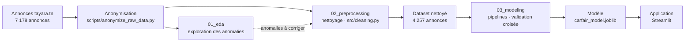

# CarFair-TN

[English](README.md) · **Français**

Predicting fair used-car prices in Tunisia using Tayara listings, XGBoost, and Streamlit.

[](https://carfair-tn.streamlit.app/)

[](https://www.python.org/)
[](https://scikit-learn.org/)
[](https://xgboost.ai/)
[](https://streamlit.io/)

**CarFair-TN** estime le juste prix d'une voiture d'occasion en Tunisie à partir de ses caractéristiques (marque,
modèle, année, kilométrage, motorisation…). Le modèle est entraîné sur des annonces publiées sur
[tayara.tn](https://www.tayara.tn), l'un des principaux sites de petites annonces du pays.

## Sommaire

- [Résultats](#résultats)
- [Données](#données)
- [Le défi : des données de marketplace](#le-défi--des-données-de-marketplace)
- [Démarche](#démarche)
- [Choix techniques](#choix-techniques)
- [Structure du dépôt](#structure-du-dépôt)
- [Installation](#installation)
- [Reproduire les résultats](#reproduire-les-résultats)
- [Application](#application)
- [Utiliser le modèle](#utiliser-le-modèle)
- [Limites et pistes d'amélioration](#limites-et-pistes-damélioration)
- [Auteur](#auteur)

## Résultats

Sur des annonces jamais vues pendant l'entraînement (jeu de test de 852 annonces) :

| | Règle simple (médiane des voitures similaires) | Modèle CarFair-TN |
|---|---|---|
| Erreur relative médiane | 17.2 % | **10.4 %** |
| Erreur absolue moyenne | 15 308 TND | **7 870 TND** |
| Estimations à ±10 % du prix de l'annonce | 32 % | **48 %** |
| Estimations à ±20 % du prix de l'annonce | 54 % | **78 %** |

Le modèle retenu est un XGBoost optimisé, entraîné sur le logarithme du prix. Un SVR et une moyenne Ridge + XGBoost
obtiennent des scores statistiquement équivalents en validation croisée : le modèle le plus simple a été retenu.

## Données

- **Source** : annonces publiques de la catégorie « voitures » de [tayara.tn](https://www.tayara.tn), collectées par
  scraping en novembre 2025.
- **Volume** : 7 178 annonces brutes, 17 champs (prix, kilométrage, année, marque, modèle, cylindrée, puissance
  fiscale, boîte, carburant, carrosserie, couleur, état, titre, description, identifiant d'annonce, ville, date).
- **Après nettoyage** : 4 257 annonces exploitables (`data/processed/tayara_cars_cleaned.csv`).
- **Anonymisation** : les numéros de téléphone des vendeurs (dans les titres, les descriptions et certains champs
  numériques) sont remplacés par des numéros fictifs de même format, et l'url de chaque annonce par un identifiant
  anonyme (`scripts/anonymize_raw_data.py`).
- **Données publiées** : seul le dataset nettoyé est publié. Les données brutes (originales comme anonymisées) ne le
  sont pas.
- **Usage** : projet pédagogique, réalisé dans le cadre d'un cursus universitaire ; les données ne sont pas destinées à
  un usage commercial.

## Le défi : des données de marketplace

Sur une marketplace, chaque vendeur remplit les champs comme il le souhaite. L'exploration des 7 178 annonces collectées
a montré qu'une grande partie des valeurs ne pouvait pas être utilisée telle quelle :

- des prix saisis en **milliers de dinars** (`61` pour une Polo à 61 000 TND) ou en **millimes** (`36 000 000`) ;
- des **valeurs de remplissage** pour les vendeurs qui préfèrent négocier par téléphone (`1234`, `55 111 110`) ;
- des **numéros de téléphone** dans le champ prix ;
- des **kilométrages saisis en milliers** ou collés à l'année (`1440002021` = 144 000 km + 2021) ;
- des marques par défaut, du texte de description dans les mauvais champs, des annonces republiées, des pièces
  détachées et des locations dans la catégorie « voitures ».

Plutôt que de supprimer toutes les valeurs suspectes, le nettoyage **corrige ce qui peut l'être de façon sûre**
(848 prix récupérés) et vérifie chaque correction par un contrôle de plausibilité.

## Démarche



Les notebooks se lisent dans l'ordre :

| Notebook | Contenu |
|---|---|
| [`01_eda.ipynb`](notebooks/01_eda.ipynb) | Exploration des données brutes : chaque anomalie est mise en évidence et démontrée (tableaux, graphiques, exemples). |
| [`02_preprocessing.ipynb`](notebooks/02_preprocessing.ipynb) | Correction des anomalies, ligne par ligne : déduplication, reconstruction des prix, correction du kilométrage, extraction d'informations depuis le texte des annonces, liste de référence des marques. |
| [`03_modeling.ipynb`](notebooks/03_modeling.ipynb) | Baseline, préparation adaptée à chaque famille de modèles, comparaison en validation croisée (Ridge, SVR, Random Forest, XGBoost), optimisation, sélection de variables par permutation, évaluation finale sur le jeu de test. |

Quelques principes suivis tout au long du projet :

- **Pas de fuite de données** : le nettoyage ne fait que des corrections ligne par ligne ; toute statistique apprise
  (imputation, encodage) l'est dans des pipelines scikit-learn, sur les données d'entraînement uniquement.
- **Un jeu de test mis de côté dès le départ** et utilisé une seule fois, à la fin. Tous les choix sont faits en
  validation croisée.
- **Des métriques en dinars**, en plus des métriques techniques.
- **Un seul fichier de modèle** contenant tout le pipeline (imputation, encodage, modèle).

## Choix techniques

| Question | Choix | Pourquoi |
|---|---|---|
| Valeurs aberrantes | **corriger plutôt que supprimer** quand la correction est sûre | un prix de `61` pour une Polo 2020 est un prix en milliers, pas une erreur : 848 prix récupérés, chacun vérifié par comparaison avec des voitures similaires |
| Cible | **logarithme du prix**, prédictions ramenées en dinars | les erreurs qui comptent sont relatives (10 000 TND d'écart n'ont pas le même poids sur une citadine et sur un 4x4), et quelques voitures de luxe ne dominent plus l'apprentissage |
| Préparation des données | **adaptée à chaque famille de modèles** | one-hot et standardisation pour les modèles linéaires ; catégories et valeurs manquantes gérées nativement par XGBoost. Le regroupement des modèles rares et le target encoding ont été testés, sans gain |
| Choix du modèle | **XGBoost seul** plutôt qu'une moyenne Ridge + XGBoost | scores équivalents en validation croisée : la règle du un écart-type retient le plus simple. Une comparaison appariée sur 25 folds montre en plus qu'XGBoost est plus précis sur une voiture typique (erreur médiane plus basse sur 96 % des folds) |
| Évaluation | **jeu de test utilisé une seule fois** | tous les choix sont faits en validation croisée, pour que la performance annoncée ne soit pas optimiste |

## Structure du dépôt

```
CarFair-TN/
├── data/
│   ├── raw/                     annonces brutes anonymisées (non publiées)
│   └── processed/
│       ├── tayara_cars_cleaned.csv   dataset nettoyé (sortie de 02_preprocessing)
│       └── test_ids.csv              annonces du jeu de test (découpage reproductible)
├── notebooks/                   01_eda, 02_preprocessing, 03_modeling
├── src/
│   ├── cleaning.py              règles de nettoyage (sans apprentissage)
│   ├── features.py              transformations apprises sur l'entraînement (imputations…)
│   ├── models.py                baseline
│   └── evaluation.py            métriques (dont les métriques en dinars)
├── models/
│   ├── carfair_model.joblib     pipeline complet entraîné
│   └── carfair_model_metadata.json   variables, performances, versions des bibliothèques
├── app/                         application Streamlit
├── scripts/
│   └── anonymize_raw_data.py    anonymisation des données brutes avant publication
└── requirements.txt
```

## Installation

Python 3.10 à 3.12 (développé en 3.10 ; la démo en ligne tourne en 3.12).

```bash
git clone https://github.com/abdelhedy/CarFair-TN.git
cd CarFair-TN
python -m venv .venv
.venv\Scripts\activate          # Windows ; sous Linux / macOS : source .venv/bin/activate
pip install -r requirements.txt
```

Les notebooks s'ouvrent ensuite dans VS Code ou Jupyter, avec l'environnement `.venv`.

## Reproduire les résultats

Les notebooks s'exécutent dans l'ordre, chacun utilisant ce que produit le précédent :

| Étape | Produit | Durée indicative |
|---|---|---|
| `01_eda.ipynb` | constats sur les données brutes | quelques secondes |
| `02_preprocessing.ipynb` | `data/processed/tayara_cars_cleaned.csv` | quelques secondes |
| `03_modeling.ipynb` | `models/carfair_model.joblib` et ses métadonnées | environ 5 minutes |

Les découpages et les modèles utilisent une graine aléatoire fixe : une nouvelle exécution redonne les mêmes résultats.

Les données brutes n'étant pas publiées, `01_eda.ipynb` et `02_preprocessing.ipynb` se consultent avec leurs résultats
déjà affichés. `03_modeling.ipynb` et l'application se relancent à partir du dataset nettoyé publié.

## Application

Démo en ligne : **[carfair-tn.streamlit.app](https://carfair-tn.streamlit.app/)**

Pour la lancer en local :

```bash
streamlit run app/streamlit_app.py
```

L'application s'ouvre dans le navigateur (`http://localhost:8501`). Elle est disponible en français et en anglais
(sélecteur FR | EN dans la barre de navigation). On choisit la marque et le modèle, l'année et le kilométrage ; les
autres caractéristiques sont pré-remplies avec les valeurs les plus courantes pour ce modèle et peuvent être ajustées.
L'application affiche :

- le **prix estimé** et une **fourchette probable** : sur le jeu de test, le prix de l'annonce tombe dans cette fourchette
  dans 3 cas sur 4 (sa largeur dépend de la gamme de prix) ;
- la **comparaison du prix d'une annonce** : on saisit le prix demandé, l'application indique s'il est bas, dans la
  norme ou élevé par rapport à la fourchette ;
- les **annonces similaires** du dataset (même modèle, année à ±1 an) : leur nombre, la zone où se situe la moitié
  d'entre elles et leur prix médian, placés sur une barre avec l'estimation et le prix saisi ;
- un **avertissement** quand l'estimation est moins fiable : modèle rare dans les données, ou annonces similaires aux
  prix très dispersés.

## Utiliser le modèle

```python
import joblib
import numpy as np
import pandas as pd

model = joblib.load("models/carfair_model.joblib")   # à lancer depuis la racine du dépôt

voiture = pd.DataFrame([{
    "kilometrage": 85000, "annee": 2018, "cylindree": 1.2, "puissance_fiscale": 5,
    "marque": "peugeot", "modele": "208", "boite": "manuelle", "carburant": "essence",
    "type_de_carrosserie": "compacte", "etat_du_vehicule": "avec kilometrage",
}])
prix = np.expm1(model.predict(voiture))[0]
print(f"Prix estimé : {prix:,.0f} TND")   # Prix estimé : 30,293 TND
```

Les catégories sont écrites en minuscules, sans accents, comme dans `data/processed/tayara_cars_cleaned.csv`. Les
valeurs inconnues peuvent être laissées vides (`None`) : le pipeline les gère.

## Limites et pistes d'amélioration

- Le modèle ne voit ni l'état réel du véhicule ni ses options : c'est la principale source d'erreur restante, surtout
  pour les voitures anciennes (moins de 20 000 TND).
- Certaines annonces ont un prix qui ne reflète pas une vente normale (épave, douane non payée, transfert de leasing) :
  elles pourraient être repérées par mots-clés.
- La ville de l'annonce, renseignée pour 43 % des annonces seulement, n'est pas encore exploitée.
- Les données couvrent les annonces de novembre 2025 : le modèle devra être réentraîné à mesure que le marché évolue.

## Auteur

Projet réalisé par Yasmine Abdelhedi.
