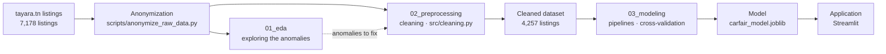

# CarFair-TN

**English** · [Français](README.fr.md)

Predicting fair used-car prices in Tunisia using Tayara listings, XGBoost, and Streamlit.

[](https://carfair-tn.streamlit.app/)

[](https://www.python.org/)
[](https://scikit-learn.org/)
[](https://xgboost.ai/)
[](https://streamlit.io/)

**CarFair-TN** estimates the fair price of a used car in Tunisia from its specifications (make, model, year, mileage,
engine…). The model is trained on listings from [tayara.tn](https://www.tayara.tn), one of the country's leading
classifieds sites.

## Contents

- [Results](#results)
- [Data](#data)
- [The challenge: marketplace data](#the-challenge-marketplace-data)
- [Approach](#approach)
- [Technical choices](#technical-choices)
- [Repository structure](#repository-structure)
- [Installation](#installation)
- [Reproducing the results](#reproducing-the-results)
- [Application](#application)
- [Using the model](#using-the-model)
- [Limitations and next steps](#limitations-and-next-steps)
- [Author](#author)

## Results

On a held-out test set of 852 listings never seen during training:

| | Simple rule (median of similar cars) | CarFair-TN model |
|---|---|---|
| Median relative error | 17.2% | **10.4%** |
| Mean absolute error | 15,308 TND | **7,870 TND** |
| Estimates within ±10% of the asking price | 32% | **48%** |
| Estimates within ±20% of the asking price | 54% | **78%** |

The final model is a tuned XGBoost regressor trained on the log of the price. An SVR and a Ridge + XGBoost average
achieve statistically equivalent cross-validation scores, so the simpler model was kept.

## Data

- **Source**: public listings from the "cars" section of [tayara.tn](https://www.tayara.tn), scraped in November
  2025.
- **Volume**: 7,178 raw listings, 17 fields (price, mileage, year, make, model, engine size, tax horsepower,
  transmission, fuel, body type, color, condition, title, description, listing identifier, city, date).
- **After cleaning**: 4,257 usable listings (`data/processed/tayara_cars_cleaned.csv`).
- **Anonymization**: sellers' phone numbers (in titles, descriptions and some numeric fields) are replaced with fake
  numbers of the same format, and each listing's URL with an anonymous identifier (`scripts/anonymize_raw_data.py`).
- **Published data**: only the cleaned dataset is published, not the raw data (original or anonymized).
- **Usage**: academic project completed as part of a university degree; the data is not intended for commercial use.

## The challenge: marketplace data

On a marketplace, sellers fill in the fields however they like. Exploring the 7,178 collected listings showed that a
large share of the values could not be used as is:

- prices entered in **thousands of dinars** (`61` for a Polo at 61,000 TND) or in **millimes** (`36 000 000`);
- **placeholder values** from sellers who prefer to negotiate over the phone (`1234`, `55 111 110`);
- **phone numbers** in the price field;
- **mileages entered in thousands**, or concatenated with the year (`1440002021` = 144,000 km + 2021);
- makes left at the form's default value, description text in the wrong fields, reposted listings, and spare parts
  or rentals listed under "cars".

Rather than dropping every suspicious value, the cleaning step **fixes what can be fixed safely** (848 prices
recovered) and validates each fix with a plausibility check.

## Approach



The notebooks (written in French) are meant to be read in order:

| Notebook | Content |
|---|---|
| [`01_eda.ipynb`](notebooks/01_eda.ipynb) | Exploration of the raw data: each anomaly is identified and illustrated with tables, charts and examples. |
| [`02_preprocessing.ipynb`](notebooks/02_preprocessing.ipynb) | Row-level fixes for the anomalies: deduplication, price recovery, mileage correction, information extracted from the listing text, and a reference list of makes. |
| [`03_modeling.ipynb`](notebooks/03_modeling.ipynb) | Baseline, preprocessing tailored to each model family, cross-validated comparison (Ridge, SVR, Random Forest, XGBoost), hyperparameter tuning, permutation-based feature selection, and final evaluation on the test set. |

Principles applied throughout the project:

- **No data leakage**: cleaning is limited to row-level fixes; anything learned from the data (imputation, encoding)
  is fitted inside scikit-learn pipelines, on the training data only.
- **A test set held out from the start** and used only once, at the very end. All modeling decisions are made with
  cross-validation.
- **Metrics in dinars**, alongside the standard technical metrics.
- **A single model file** containing the full pipeline (imputation, encoding, model).

## Technical choices

| Question | Choice | Why |
|---|---|---|
| Outliers | **fix rather than drop** when the fix is safe | a price of `61` for a 2020 Polo is a price in thousands, not an error; 848 prices were recovered, each checked against similar cars |
| Target | **log of the price**, with predictions converted back to dinars | what matters is relative error (a 10,000 TND error means far more on a city car than on an SUV), and a handful of luxury cars no longer dominate training |
| Data preparation | **tailored to each model family** | one-hot encoding and scaling for linear models; native handling of categories and missing values for XGBoost. Grouping rare models and target encoding were tested, with no improvement |
| Model choice | **XGBoost alone** rather than a Ridge + XGBoost average | equivalent cross-validation scores, so the one-standard-error rule favors the simpler model. A paired comparison over 25 folds also shows that XGBoost is more accurate on a typical car (lower median error on 96% of folds) |
| Evaluation | **test set used only once** | all decisions are made with cross-validation, so the reported performance is not optimistically biased |

## Repository structure

```
CarFair-TN/
├── data/
│   ├── raw/                     anonymized raw listings (not published)
│   └── processed/
│       ├── tayara_cars_cleaned.csv   cleaned dataset (output of 02_preprocessing)
│       └── test_ids.csv              test set listing IDs (reproducible split)
├── notebooks/                   01_eda, 02_preprocessing, 03_modeling
├── src/
│   ├── cleaning.py              cleaning rules (nothing learned from data)
│   ├── features.py              transformations learned on the training data (imputations…)
│   ├── models.py                baseline
│   └── evaluation.py            metrics (including metrics in dinars)
├── models/
│   ├── carfair_model.joblib     complete trained pipeline
│   └── carfair_model_metadata.json   features, performance, library versions
├── app/                         Streamlit application
├── scripts/
│   └── anonymize_raw_data.py    anonymizes the raw data before publication
└── requirements.txt
```

## Installation

Python 3.10 to 3.12 (developed with 3.10; the online demo runs on 3.12).

```bash
git clone https://github.com/abdelhedy/CarFair-TN.git
cd CarFair-TN
python -m venv .venv
.venv\Scripts\activate          # Windows; on Linux / macOS: source .venv/bin/activate
pip install -r requirements.txt
```

You can then open the notebooks in VS Code or Jupyter using the `.venv` environment.

## Reproducing the results

Run the notebooks in order; each one uses the output of the previous one:

| Step | Output | Approx. runtime |
|---|---|---|
| `01_eda.ipynb` | findings on the raw data | a few seconds |
| `02_preprocessing.ipynb` | `data/processed/tayara_cars_cleaned.csv` | a few seconds |
| `03_modeling.ipynb` | `models/carfair_model.joblib` and its metadata | about 5 minutes |

All splits and models use a fixed random seed, so re-running the notebooks gives the same results.

Since the raw data is not published, `01_eda.ipynb` and `02_preprocessing.ipynb` are provided with their
outputs already rendered. `03_modeling.ipynb` and the app can be re-run from the published cleaned dataset.

## Application

Live demo: **[carfair-tn.streamlit.app](https://carfair-tn.streamlit.app/)**

To run it locally:

```bash
streamlit run app/streamlit_app.py
```

The app opens in your browser at `http://localhost:8501`. It is available in French and English (FR | EN switch in the
navigation bar). Pick the make and model, the year and the mileage; the other specs are pre-filled with the most common
values for that model and can be adjusted. The app shows:

- the **estimated price** and a **likely range**, which contained the asking price in 3 out of 4 cases on the test
  set (its width depends on the price level);
- a **listing price check**: enter a listing's asking price to see whether it is below, in line with, or above the
  market;
- **similar listings** from the dataset (same model, year ±1): how many there are, the price range of the middle half,
  and the median price, plotted on a bar alongside the estimate and the price entered;
- a **warning** when the estimate is less reliable: a model with few listings in the data, or similar listings whose
  prices vary widely.

## Using the model

```python
import joblib
import numpy as np
import pandas as pd

model = joblib.load("models/carfair_model.joblib")   # run from the repository root

car = pd.DataFrame([{
    "kilometrage": 85000, "annee": 2018, "cylindree": 1.2, "puissance_fiscale": 5,
    "marque": "peugeot", "modele": "208", "boite": "manuelle", "carburant": "essence",
    "type_de_carrosserie": "compacte", "etat_du_vehicule": "avec kilometrage",
}])
price = np.expm1(model.predict(car))[0]
print(f"Estimated price: {price:,.0f} TND")   # Estimated price: 30,293 TND
```

Column names and categories follow the dataset, which is in French: lowercase and without accents, as in
`data/processed/tayara_cars_cleaned.csv`. Unknown values can be set to `None`; the pipeline handles them.

## Limitations and next steps

- The model cannot see the car's actual condition or its options. This is the main remaining source of error,
  especially for older cars (under 20,000 TND).
- Some listings are priced for something other than a regular sale (salvage cars, unpaid customs duties, lease
  transfers); these could be flagged with keywords.
- The listing's city, available for only 43% of listings, is not used yet.
- The data covers November 2025 listings only, so the model will need retraining as the market changes.

## Author

Project by Yasmine Abdelhedi.
